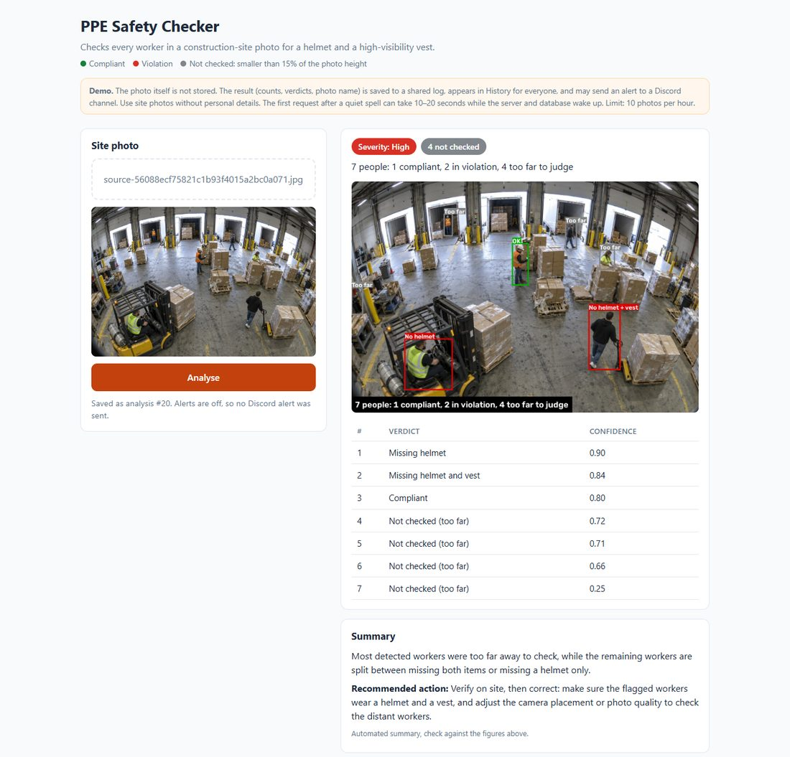
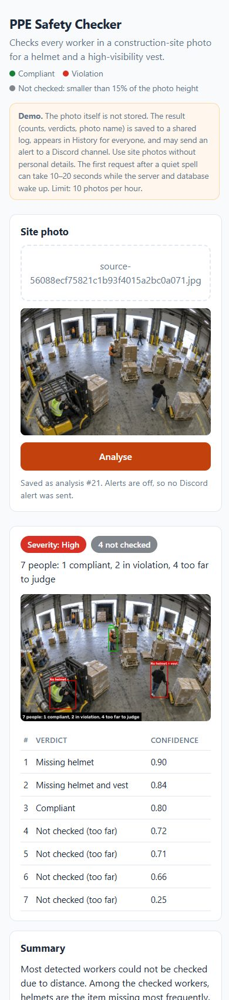
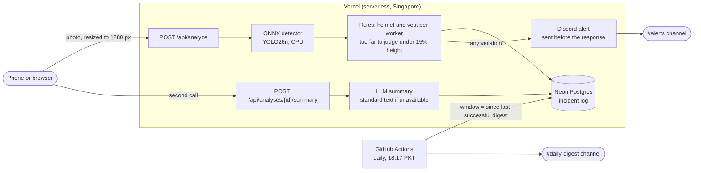

# PPE Safety Checker

[](https://github.com/farzeen-khaan/ppe-safety-checker/actions/workflows/ci.yml)
[](https://github.com/farzeen-khaan/ppe-safety-checker/actions/workflows/digest.yml)

**Upload a construction-site photo; every worker is checked for a helmet and a high-visibility vest, violations are alerted on Discord, and a daily digest summarises the site.**

**Live demo:** https://ppe-safety-checker.vercel.app · **API docs:** https://ppe-safety-checker.vercel.app/docs

<p align="center">
  
  
</p>

A portfolio project: a fine-tuned vision model, rule-based decisions, an LLM layer that writes plain-language summaries, and two automations, all running on free tiers.

## How it works



1. **Detect.** A YOLO26n model, fine-tuned on construction-site photos, finds people, helmets, vests and their "missing" counterparts. In production it runs as ONNX on CPU (about 40 ms per image), with no PyTorch in the deployed app.
2. **Decide.** Plain rules, not the model, decide each worker's verdict:
   - a helmet or vest belongs to a person when at least half of its box is inside theirs, at the right height;
   - workers smaller than 15% of the photo height are marked **too far to judge** instead of guessed.
3. **Show and save.** The page shows the verdicts in about a second of server time. The analysis is saved (counts and verdicts only, never the photo), and an alert goes to Discord if anyone is in violation.
4. **Summarise.** A second call asks a language model for a short summary and action ("Verify on site, then correct: …"). It's built from the counts only, labelled as automated, and replaced by a standard template if the model is unavailable.
5. **Digest.** Once a day, GitHub Actions summarises everything since the last successful digest and posts it to Discord. It covers every period exactly once, however late the scheduler starts.

## Results

**Detection** (YOLO26n, 50 epochs at 640 px, the 200-image validation split):

| Class | Precision | Recall | mAP50 |
| --- | --- | --- | --- |
| All 12 classes | 0.854 | 0.683 | **0.747** |
| Person | 0.933 | 0.890 | 0.942 |
| vest | 0.952 | 0.835 | 0.886 |
| helmet | 0.924 | 0.782 | 0.833 |
| no\_vest | 0.903 | 0.638 | 0.711 |
| no\_helmet | 0.860 | 0.547 | 0.658 |

**Verdicts** (the rules on the model's boxes vs. the same rules on the human labels; 200 images, 481 people; confidence 0.4):

| | Accuracy on judged workers | Coverage (workers judged) |
| --- | --- | --- |
| Without the "too far to judge" rule | 79% | 88% |
| **With it (under 15% of the photo height → not judged)** | **93%** | **64%** |

At the deployed confidence threshold of 0.25: **94%** accuracy at 64% coverage, with the fewest silent misses and false alarms of the thresholds tried.

- **Why "too far to judge":** below 15% of the photo height, a helmet is a few pixels wide and verdicts were under 60% correct. Those workers are counted and shown grey, never silently called compliant.
- **Hand check:** a hand check of 20 photos found every annotation correct.
- **Coverage tops out at 88%,** because the model misses about 12% of people entirely.

**ONNX vs. PyTorch** (20-image check set):
- With identical input: every box matches, IoU ≥ 0.9995, confidence difference 0.000.
- Per-person verdicts: identical on 20 of 20 images.

**Live (Vercel, phone-width browser, Nov 2026):**
- verdicts **3.8 s** after the click, including the Discord alert; summary **2.9 s** later;
- server work 0.45 s;
- cold starts: the page in 5.2 s after 20 idle minutes; the first analysis in 7.7 s after about 8 idle hours.

## The automations

- **Violation alert (Discord).** Sent inside the analysis request, before the response, because a serverless function may be frozen afterwards.
  - **Content:** an embed coloured by severity, the counts as fields, and the annotated photo.
  - **Delivery:** one retry, honours Discord's rate limits; the webhook URL never appears in logs or the database.
  - A photo with only distant workers never alerts.
- **Daily digest (GitHub Actions → Discord).**
  - **Covers:** analyses, people checked, violations by type, severity, the three worst analyses, a short summary, and how many alerts were sent and how many summaries were automated.
  - **Window:** starts where the last successful digest ended. A run that starts hours late (GitHub's free scheduler did, by 5–11 hours) still covers each period exactly once; a duplicate run is skipped and recorded.
  - Empty days get a short "no analyses" message, so silence never means failure.

## Tech stack

| Part | Choice |
| --- | --- |
| Model | Ultralytics YOLO26n, fine-tuned on Colab (T4); served as ONNX with ONNX Runtime (CPU) |
| Rules and drawing | Python; OpenCV (headless) for decoding, letterboxing and drawing |
| API and page | FastAPI + one plain HTML/CSS/JS page (no framework) |
| Hosting | Vercel Hobby, Python 3.12, region `sin1` (Singapore) |
| Incident log | Postgres on Neon (free plan; `main`, `dev` and `test` branches), psycopg 3, short-lived connections |
| Summaries | Gemini Flash-Lite through one provider-neutral module (`src/llm.py`), with a template fallback |
| Alerts and digest | Discord webhooks; GitHub Actions cron |
| Tests | pytest (about 280 tests), GitHub Actions CI on every push and pull request |

## API

| Endpoint | Does |
| --- | --- |
| `POST /api/analyze` | Photo (JPG/PNG/WEBP, ≤ 3 MB) → verdicts, counts, severity, annotated JPEG; saves the analysis and sends the alert |
| `POST /api/analyses/{id}/summary` | Writes and saves the summary (automated, or standard if the model is unavailable) |
| `GET /api/history` | Recent analyses, newest first |
| `GET /api/analyses/{id}` | One analysis with per-person verdicts |
| `GET /api/health` | Liveness and database reachability |

- **Errors:** 400 unreadable image, 413 too large, 415 wrong type, 404 unknown id, 429 rate limited (10 analyses per client per hour), 503 database waking up (with `Retry-After`).
- **Interactive docs:** [`/docs`](https://ppe-safety-checker.vercel.app/docs).

## Run it locally

Needs Python 3.12 and a Postgres database (a free [Neon](https://neon.tech) project works; use the pooled connection string).

```bash
git clone https://github.com/farzeen-khaan/ppe-safety-checker.git
cd ppe-safety-checker
python -m venv .venv && source .venv/bin/activate     # Windows: .venv\Scripts\activate
pip install -r requirements-dev.txt                    # the app + training/export/test tools
cp .env.example .env                                    # then fill in DATABASE_URL, RATE_LIMIT_SALT, ...
uvicorn app:app --reload                                # http://127.0.0.1:8000
```

- **`RATE_LIMIT_SALT`:** any secret of at least 32 characters, for example `python -c "import secrets; print(secrets.token_hex(32))"`.
- **Optional settings:** `LLM_API_KEY` (summaries fall back to the standard text without it), and `DISCORD_WEBHOOK_URL` with `ALERTS_ENABLED=true`.
- **Tests:** `python -m pytest -m "not live"`. Database tests run when `DATABASE_URL_TEST` points at a separate test database; otherwise they skip.
- **Digest:** `python -m src.digest --dry-run` (prints, sends nothing).
- **Model:** `python -m tools.export_onnx` re-exports `models/best.onnx` from `models/best.pt`; `python -m tools.parity` compares it with PyTorch. Both need the dataset in `data/construction-ppe` (from [Ultralytics](https://docs.ultralytics.com/datasets/detect/construction-ppe)).
- **Deploying your own copy:** [`DEPLOY.md`](DEPLOY.md).

## Limitations

- **Distant workers aren't judged.** About a quarter of the workers in the validation photos (116 of 481) are under 15% of the photo height and are shown as "not checked", and the model misses about 12% of people entirely. The check is reliable for workers it judges, and honest about the rest; it isn't a substitute for walking the site.
- **Small changes can move borderline workers.** Resizing a 2048 px photo to 1280 px in the browser left compliant and violation counts unchanged on 20 of 20 test photos, but changed the number of distant workers detected on 2.
- **Evaluated on the dataset's own validation split.** The dataset's authors recommend independent imagery from real deployments for a final evaluation; that hasn't been done.
- **The model sees helmets and vests only.** Not gloves, boots or goggles, and no checks of whether equipment is worn correctly.
- **Free tiers mean cold starts:**
  - the first request after a quiet spell can take 5–10 s while Vercel and Neon wake;
  - the scheduled digest can start hours late (it still covers every period, but arrives when GitHub runs it).
- **Summaries are automated.** They're built from counts only and labelled as such, but can still word things oddly. Check them against the figures.
- **The demo log is shared and public.** Anyone's analyses appear in History. Rate limiting is per IP address, so a client whose address changes starts a fresh limit.

## Towards production

- **A job queue for alerts and summaries,** so the request returns after the save, and alerts can include the written summary and retry independently.
- **Authentication and per-site data,** replacing the shared public log and IP-based rate limits.
- **A least-privilege database role for the digest** (read analyses, write digest runs only), separate from the app's.
- **Monitoring:** error tracking, uptime checks on `/api/health`, and an alert when a scheduled digest is missing.
- **Model upgrades:**
  - a larger model or higher input resolution for distant workers;
  - more data for `no_helmet` (recall 0.55);
  - evaluation on independent site photos;
  - a model registry with a parity gate before deployment.

## Credits and licences

- **Dataset:** Ultralytics Construction-PPE Dataset, Ultralytics team, November 2026, [CC BY 4.0](https://creativecommons.org/licenses/by/4.0/) ([dataset page](https://docs.ultralytics.com/datasets/detect/construction-ppe)). Used to fine-tune the model. The screenshots above show a validation image from it, changed by this app: resized, with boxes and labels drawn. The dataset itself is not included in this repository.
- **Model and training:** [Ultralytics YOLO](https://github.com/ultralytics/ultralytics) (YOLO26n), [AGPL-3.0](https://ultralytics.com/license). The fine-tuned weights (`models/best.pt`, `models/best.onnx`) are derived from it.
- **This project:** [AGPL-3.0](LICENSE).
